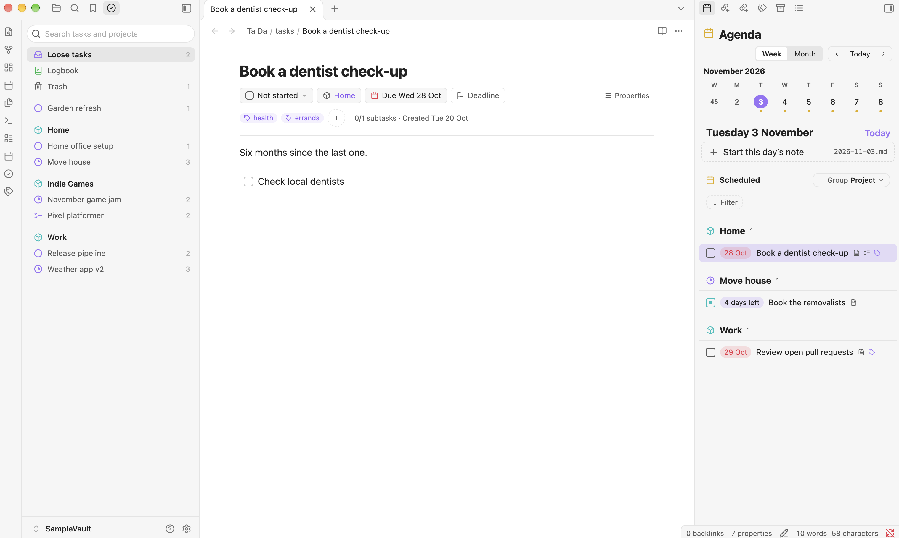
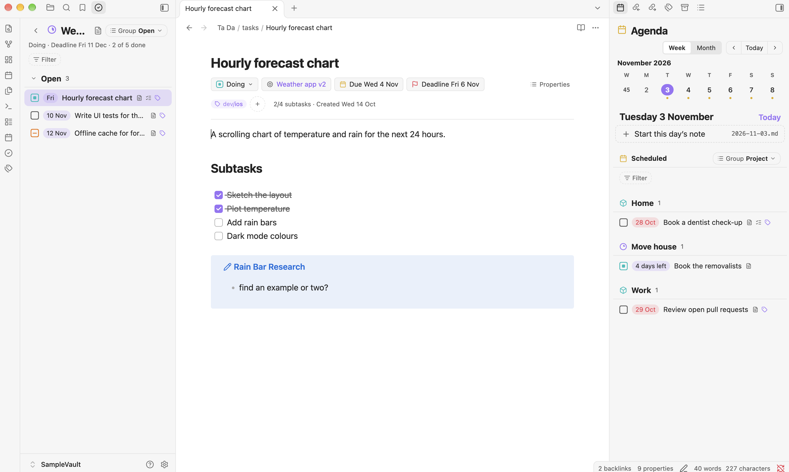
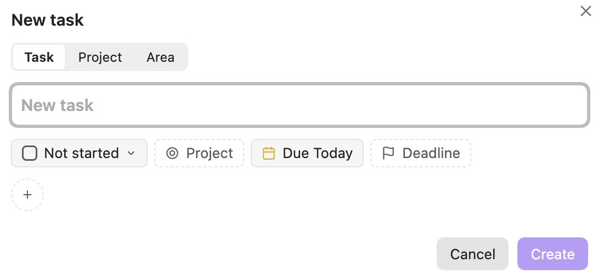
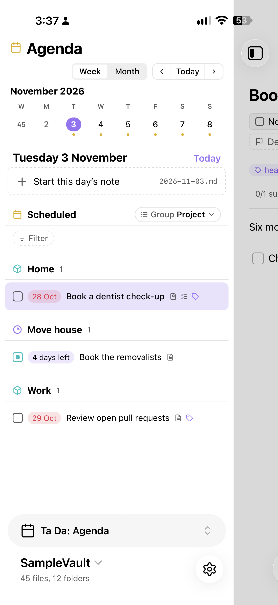
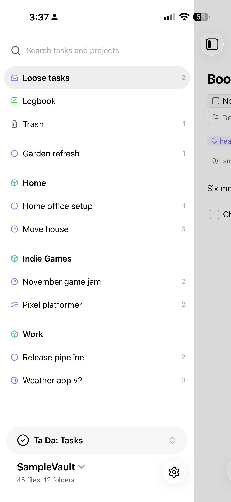
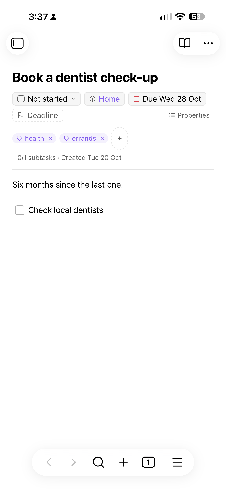

# Ta Da for Obsidian

Ta Da for Obsidian is a standalone plugin that replicates most of the capabilities of the [Ta Da](https://github.com/lobrenov/ta-da-swift) app for macOS and iOS. It can be run standalone or concurrently, and works on desktop and mobile.

Ta Da is a "one task, one file" based to-do list concept, with tasks, projects, and areas, tag organisation, repeating tasks, in-task checkboxes for subtasks, and periodical notes. 

> **AI Disclaimer:** Ta Da and its Obsidian plugin version are 100% vibe-coded. I've no intention of claiming that "I made" Ta Da or could quickly or easily re-create it myself. It almost definitely has many AI-isms in its visual design and codebase.

<picture>
  <source media="(prefers-color-scheme: dark)" srcset="docs/images/agenda-dark.png">
  
</picture>

## How it works
- **Tasks, Projects, Areas**: one file per task, project or area. Properties, e.g. status, due dates, deadlines, repeats, are defined in YAML frontmatter. Ta Da uses `type: task, project, area` to identify Ta Da files. 
- **Custom properties header**: Ta Da files have a custom-rendered properties row for status, project, area, dates and tags.
- **Dates and repetitions**: due dates, deadlines and repetition log are parsed using natural language.
- **Agenda view**: a week or month strip and a day's or a week's tasks, with the daily or weekly note.
- **Tasks and Tags views**: areas with their projects, Loose tasks, the Logbook and Trash, and the tag tree, each in a sidebar tab with grouping and a tag filter.
- **New task menu**: a new task command for a task, project or area. I recommend binding to e.g. `CTRL / ⌘ + Shift + N`.
- **File menu**: Move, Schedule, Set deadline, Tags and Status on one file, or on several picked rows. 
- **Logging**: once a day, completed tasks and projects move to the Logbook and completed repeating tasks move forward.

  <picture>
    <source media="(prefers-color-scheme: dark)" srcset="docs/images/tasks-dark.png">
    
  </picture>
  

  <picture>
    <source media="(prefers-color-scheme: dark)" srcset="docs/images/phone-agenda-dark.png">
    
  </picture>
  <picture>
    <source media="(prefers-color-scheme: dark)" srcset="docs/images/phone-tasks-dark.png">
    
  </picture>
  <picture>
    <source media="(prefers-color-scheme: dark)" srcset="docs/images/phone-taskfile-dark.png">
    
  </picture>

## Install
- via the Community plugins store.
- With [BRAT](https://github.com/TfTHacker/obsidian42-brat): add `lobrenov/ta-da-obsidian`.
- By hand: download `main.js`, `manifest.json` and `styles.css` from the [latest release](https://github.com/lobrenov/ta-da-obsidian/releases/latest) into `<vault>/.obsidian/plugins/ta-da/`, then turn on Ta Da in Settings ▸ Community plugins.

## Files
The plugin creates files where the apps do, in `Ta Da/` at the vault's top level, and edits them by changing only the lines it needs. Calendar events and reminders stay with the apps. The format is in Ta Da's [`docs/file-format.md`](https://github.com/lobrenov/ta-da-swift/blob/main/docs/file-format.md).

## Settings
- Hide properties on Ta Da files.
- Open Agenda, Tasks and Tags on startup, one setting each.
- Collapse the list pane.
- Daily notes: the folder and template for daily notes, and for week notes, which can be turned off. These are shared with Ta Da through `Ta Da/settings.json` in the vault.

## Development
The Ta Da repo must be cloned beside this one (`../Ta Da`), with `swift-markdown-engine-extended` beside both; the tests read their fixtures. `CLAUDE.md` has the layout and rules.

- `npm test`: Vitest, including conformance with TaDaCore.
- `npm run build`: typecheck and bundle `main.js`.
- `OBSIDIAN_VAULT=<vault> npm run dev`: watch build, copied into `<vault>/.obsidian/plugins/ta-da/`.

## Licence
MIT (`LICENSE`). Third-party notices: `ACKNOWLEDGEMENTS.txt`.
